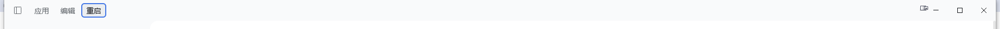
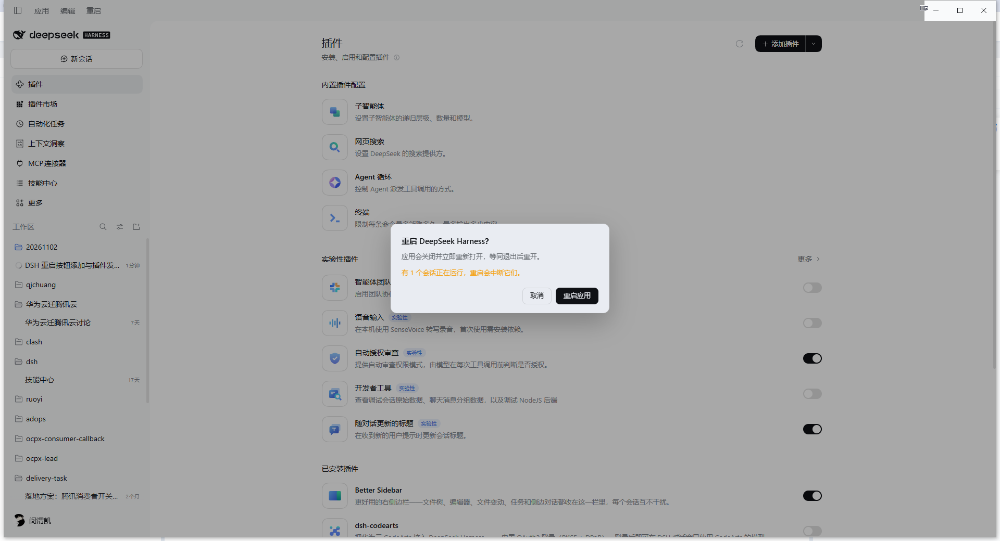

# dsh-restart

给 **DeepSeek Harness Desktop**（Windows）的标题栏加一个「重启」按钮。点一下弹出确认框，确认后应用关闭并重新打开。

> 非 DeepSeek 官方插件，社区插件。





## 安装

```sh
dsh plugin --profile desktop add github:mwk719/dsh-restart
```

也可以从插件市场（dsh-market）安装。装完**重启一次应用**，标题栏「应用 / 编辑」右边就会出现「重启」。

## 用法

1. 点「重启」（英文界面是 `Restart`）。
2. 弹出确认框：标题「重启 DeepSeek Harness？」，正文说明会关闭并重新打开，第三行告诉你**现在有几个会话正在运行、重启会中断它们**（空闲时说明没有正在运行的会话）。
3. 「取消」/ `Esc` / 点击遮罩 = 关掉，什么都不做；「重启应用」= 立刻重启。

## 为什么按钮在标题栏，而不是「应用」菜单里

「应用」弹出的菜单是 Electron **主进程**里的原生菜单，由 `app.asar` 内 `lib/main.js` 的 `applicationItems()` 构造（最后一项是「退出」）。dsh 的插件系统没有给这个菜单留插槽，桌面端也没有把 quit / restart 暴露给网页或插件，所以**插件无法往那条菜单里插条目**。

本插件改为把按钮追加进**同一个标题栏菜单行**——桌面端 preload 在页面里建的 `[data-windows-menu]` 元素，其 shadow root 里那个 `[role="menubar"]`（装「应用 / 编辑」的那一行）。因此按钮紧挨「应用 / 编辑」，沿用该行的布局和按钮样式，并随界面语言显示「重启 / Restart」。

这一处是整个插件唯一依赖桌面端内部结构的地方：它只**读**这个元素的 shadow root 并往菜单行里 `append` 一个按钮，不修改既有按钮、不拦截事件。如果将来的桌面端不再提供这个元素，插件在 20 秒内找不到就什么都不渲染（不会报错、不影响其它插件）。

## 重启是怎么实现的

- 桌面端的 Host 进程就是 `DeepSeek Harness.exe` 以 Node 模式运行（`ELECTRON_RUN_AS_NODE=1`，由 Electron 主进程 spawn 并带 IPC 通道），所以在 Host 里 `process.execPath` 就是应用可执行文件，`process.ppid` 就是 Electron 主进程。
- 确认后，Host 起一个 detached 的助手进程（`restart-child.mjs`）；助手先结束 Electron 主进程，再结束 Host 进程（释放它占的 HTTP 端口），约 2 秒后用同一个可执行文件重新启动应用。
- 效果等同「退出后重新打开」：所有插件代码、原生菜单、Host 全部重新加载。

日志写在 `~/.dsh/dsh-restart.log`（每次弹框、确认、取消、重启都有一行，助手进程的每一步也在里面）。

## 安全边界

重启会中断正在跑的回合，所以按下的动作被刻意做成两步：

- **点一下只弹框**，不发任何请求。取消 / `Esc` / 点遮罩都只是关掉。
- **Host 侧还有第二道闸**：`POST /dsh-restart/restart` 必须带 `?force=1`（即弹框里确认过的那一次）。没有确认的按下一律返回 `409`，**绝不重启**——即使页面是旧版本的代码也一样。
- 弹框会先问 Host 现在有几个会话在跑，并把数量写在正文里，让你知道这次重启的代价。
- 20 秒后应用还在运行（说明重启没生效），弹框会改成报错文案并允许重试。

代价是真实的：**正在生成的回答会中断**。会话记录、消息、文件都在磁盘上，重开后仍在列表里。

## 要求与限制

- **仅 Windows 桌面端**：只有它才有这条标题栏菜单行（macOS 用原生应用菜单，Linux 桌面端没有这个 menubar），其它平台插件不渲染任何东西。
- 需要 `dsh >= 0.2.0-rc.1`（`dsh.engines.dsh`）。
- 零依赖、零构建：`index.js`（Host）、`client.js`（浏览器端）、`restart-child.mjs`（助手）都是手写 ESM，装完即可用，不需要 `pnpm install` 或构建步骤。
- 重启用的是「结束进程再拉起」，不是优雅退出：如果某次重启后应用没起来，手动打开一次即可（日志里有每一步的结果）。

## 诊断

Host 提供两个只读/自检路由（同源、需要自定义请求头）：

- `GET /dsh-restart/state` → `{ status, guard, desktop, busy, mounted, log }`：`busy` 是正在运行的会话数，`mounted` 是按钮挂载时间，`guard` 是当前保护版本。
- `POST /dsh-restart/restart?dry=1` → 只回答「现在按下去会怎么处理」，不会重启。

## 卸载

设置 → 插件 → `dsh-restart` → 停用或卸载，按钮随之消失。

## 文件结构

| 文件 | 作用 |
| --- | --- |
| `index.js` | Host 半区：注册 `/dsh-restart/restart`、`/dsh-restart/state`，起重启助手 |
| `client.js` | 浏览器端：把按钮追加进标题栏菜单行，渲染确认框 |
| `restart-child.mjs` | 重启助手：结束主进程与 Host，再拉起应用 |
| `cordis.patch.yml` | bundle patch，插入一行插件 |
| `locale/*.json` | 插件页里的标题与描述（中/英） |
| `icon.svg` / `icon.png` | 插件图标与市场卡片图标 |
| `screenshots.json` | 市场详情页截图声明 |

---

# English

A **Restart** button in the Windows titlebar of DeepSeek Harness Desktop. A click opens a confirmation dialog; confirming closes the app and starts it again.

- **Why the titlebar:** the Application menu is a native Electron menu built in `app.asar` (`applicationItems()`, whose last item is Quit), and it has no plugin extension point. The plugin appends a button into the same caption menubar row the desktop shell renders (`[data-windows-menu]` → shadow root → `[role="menubar"]`), so it sits right after Application / Edit.
- **How the restart works:** the desktop Host is the Electron executable running in Node mode, so `process.execPath` is the app executable and `process.ppid` is the Electron main process. A detached helper terminates both, then relaunches the executable — the same thing quitting and reopening does.
- **Two-step by design:** a click only opens the dialog and sends no request; Cancel, `Esc` and the backdrop just close it. The Host additionally requires `?force=1` on the restart request and answers `409` to anything else, so an unconfirmed press can never restart the app. The dialog names how many sessions would be interrupted.
- **Limits:** Windows desktop only (that is where the caption menubar exists); `dsh >= 0.2.0-rc.1`; no dependencies, no build step; a restart interrupts running turns, while sessions and files stay on disk.
- **Log:** `~/.dsh/dsh-restart.log`.

Install:

```sh
dsh plugin --profile desktop add github:mwk719/dsh-restart
```

## License

MIT
